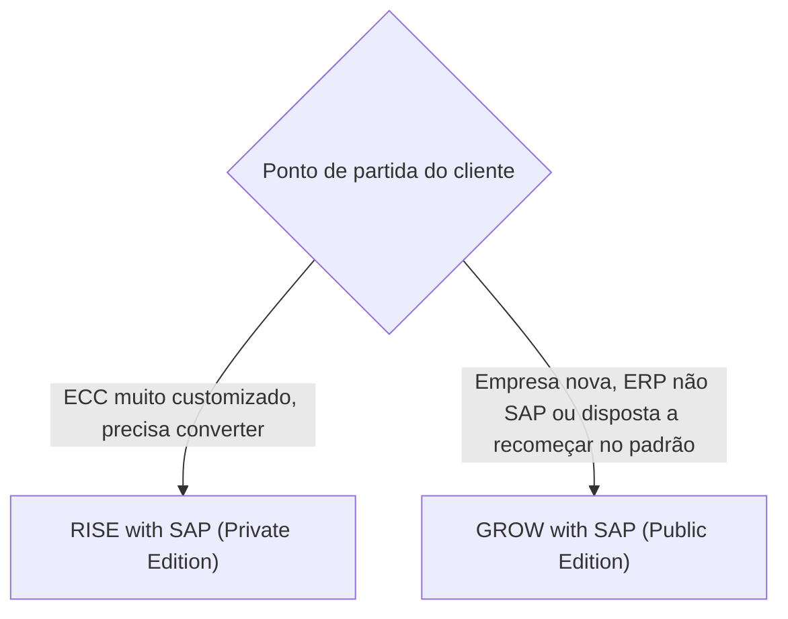

# GROW with SAP - Study

> Nível: noção
> O pacote comercial que entrega o S/4HANA Cloud Public Edition, voltado a empresas de médio porte e implantações novas. Estudo de leitura, sem prática no trial. Relacionados: [Cloud Public Edition](https://github.com/igor-barral/SAP-S4HANA-Cloud-Public-Edition-erp-study), [RISE with SAP](https://github.com/igor-barral/RISE-with-SAP-erp-study), [SAP S/4HANA (índice da fase 0)](https://github.com/igor-barral/SAP-S4HANA-erp-study).

## Objetivo

Entender o que é o GROW with SAP e como ele se diferencia do RISE. Como o RISE, o GROW é uma **oferta comercial**, não um produto técnico. Foi lançado em 2023 para levar o S/4HANA Cloud Public Edition a empresas de médio porte com implantação rápida e processos padrão. Para o desenvolvedor, "cliente GROW" significa: sistema SaaS, só ABAP Cloud, *fit-to-standard* e quase certamente uma implantação do zero.

Ao concluir este estudo você deverá ser capaz de responder perguntas como:

- O que vem no pacote GROW?
- Qual a diferença entre RISE e GROW?
- Por que o GROW quase sempre é *greenfield*?
- Que perfil de cliente e de projeto o GROW atrai?

---

## Ponte

| No que eu já conheço | No GROW |
|---|---|
| Plano SaaS de ERP para PME, com implantação padronizada e parceiro certificado | GROW: Public Edition com metodologia e conteúdo prontos |
| Trocar um sistema antigo por um SaaS e só migrar os cadastros e saldos | Implantação nova com migração de dados, sem levar o sistema antigo |
| Marketplace de integrações e plataforma de apps do próprio fornecedor | SAP BTP para extensões *side-by-side* |

---

## Conteúdo

### O que vem no pacote

A composição exata varia; a estrutura geral é:

| Componente | O que é |
|---|---|
| ERP | SAP S/4HANA Cloud Public Edition |
| Plataforma | Acesso ao SAP BTP para extensões e integrações |
| Conteúdo pronto | Processos de referência (*SAP Best Practices*) e metodologia SAP Activate para implantação acelerada |
| Aprendizado e comunidade | Acesso a trilhas de SAP Learning e à comunidade de clientes |
| Ecossistema | Implantação normalmente conduzida por parceiros SAP |

Como em qualquer oferta comercial, confirme o escopo atual na página oficial; componentes e nomes mudam.

### RISE e GROW lado a lado

| | RISE with SAP | GROW with SAP |
|---|---|---|
| ERP | S/4HANA Cloud Private Edition | S/4HANA Cloud Public Edition |
| Público principal | Grandes empresas e clientes ECC | Médio porte, empresas em crescimento, subsidiárias |
| Caminho típico | Conversão, nova implantação ou transição seletiva | Nova implantação (*greenfield*) |
| Customizing | SPRO completo | Configuração guiada |
| ABAP clássico | Permitido | Não existe |
| Upgrades | Planejados com o cliente | Automáticos, calendário da SAP |
| Prazo de implantação | Longo (projeto de transformação) | Curto (implantação padronizada) |

### Por que o GROW quase sempre é greenfield

- A Public Edition **não aceita conversão de sistema**: não há como pegar um ECC e transformá-lo num tenant da Public Edition, porque o modelo SaaS não admite o customizing livre, as modificações e o código clássico que um ECC carrega.
- O modelo de implantação é *fit-to-standard*: o cliente adota os processos de referência, o que por definição é recomeçar.
- Dados do sistema anterior (cadastros, saldos, documentos em aberto) entram pelo **SAP S/4HANA Migration Cockpit**, e não pela migração do sistema. Ver [SAP-S4HANA-Migration-Cockpit-erp-study](https://github.com/igor-barral/SAP-S4HANA-Migration-Cockpit-erp-study).

### O que muda para o desenvolvedor num projeto GROW

- Todo o desenvolvimento é **ABAP Cloud** (RAP, CDS, classes, BAdIs liberadas) ou **side-by-side** no BTP (CAP, Integration Suite).
- Muita demanda é resolvida por **key user extensibility**, sem desenvolvedor; o ABAP entra quando o *key user* não basta.
- Não há legado para sustentar no próprio sistema; o legado está no sistema antigo que está sendo substituído, e o trabalho é de migração de dados e integração.
- É o cenário mais próximo do que as fases 2 a 6 do roadmap praticam na BTP ABAP Environment.

---

## Respostas

**O que vem no pacote GROW?**
A S/4HANA Cloud Public Edition, acesso ao SAP BTP, processos de referência e metodologia SAP Activate para implantação acelerada, além de recursos de aprendizado e comunidade. O escopo exato deve ser confirmado na página oficial.

**Qual a diferença entre RISE e GROW?**
RISE entrega a Private Edition, voltada a grandes empresas e clientes ECC, com customizing completo, ABAP clássico e possibilidade de conversão. GROW entrega a Public Edition, voltada a médio porte, com configuração guiada, só ABAP Cloud, upgrades automáticos e implantação nova.

**Por que o GROW quase sempre é greenfield?**
Porque a Public Edition não aceita conversão de sistema e é implantada por *fit-to-standard*. O que vem do sistema anterior são dados, carregados pelo Migration Cockpit, não o sistema em si.

**Que perfil de cliente e de projeto o GROW atrai?**
Empresas de médio porte, subsidiárias de grupos que já usam SAP, empresas novas ou que trocam um ERP não SAP e que aceitam o processo padrão. Projetos curtos, com foco em configuração, *key user extensibility*, migração de dados e integração.

---

## Referências

- SAP (página do produto): https://www.sap.com (buscar "GROW with SAP")
- SAP Learning: https://learning.sap.com (buscar "GROW with SAP", "SAP S/4HANA Cloud Public Edition")
- SAP Community: https://community.sap.com (buscar "GROW with SAP")
